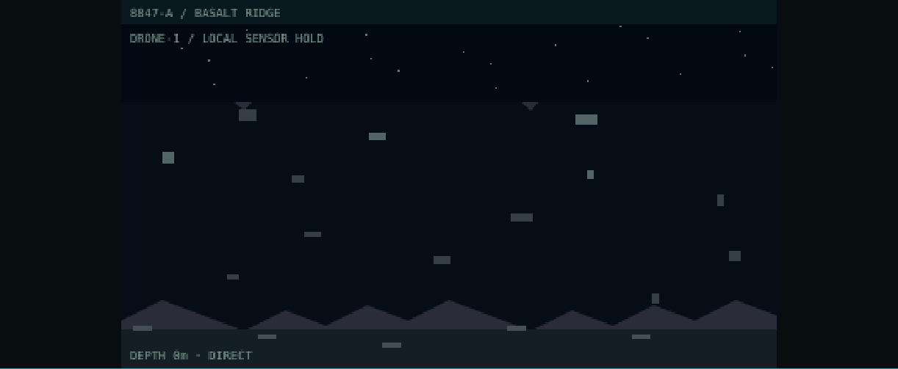

# Actual Phase 4.6 exploration and boot captures

These are unedited screenshots from the running Linux Chromium application, using the existing Phase4.5 detailed renderer. The exploration fixture makes an existing engineer initially available at C04 and holds navigation; it does **not** inject a drone, map discovery, sensor result, recording, injury, creature or encounter. Autonomous paid assembly, charge, physical launch and connected traversal produce the observed Basalt Ridge camera state. The capture test compares the displayed primary canvas pixel data to that same authoritative received room DTO before taking the screenshot. `screenshots/capture_source.json` retains the exact tick/device/camera DTO. This is a technical test world, not the user's voyage or physical camera footage.

[Primary drone camera](screenshots/actual_drone_camera.png) · [Bridge camera selection](screenshots/bridge_drone_camera.png) · [Exploration interface](screenshots/exploration_interface.png)

[Boot ready, waiting for explicit ENTER](screenshots/boot_ready_waiting_for_entry.png) demonstrates that readiness does not dismiss the screen or clear a partially entered key. [Initialization](screenshots/initialization/startup.png) holds an actual bootstrap response in the local test transport; no readiness or fake progress is manufactured. The source JSON identifies that deliberate delay.

No Windows, Android or television screenshot is claimed. The art remains procedural and sector-based; human/device review and the documented visual/physical limits remain.
