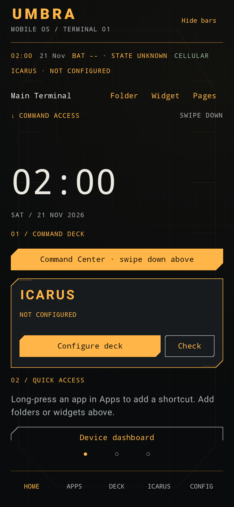
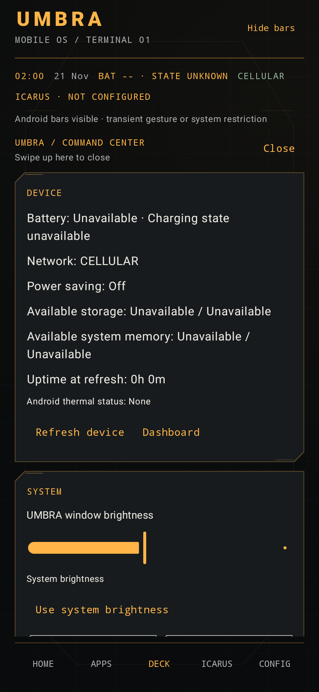
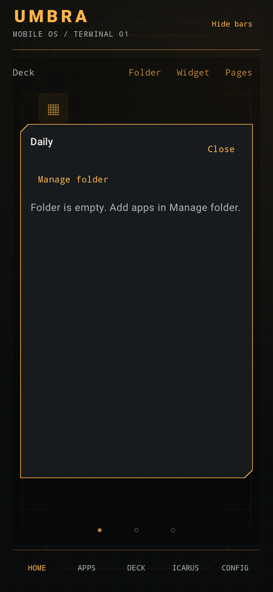
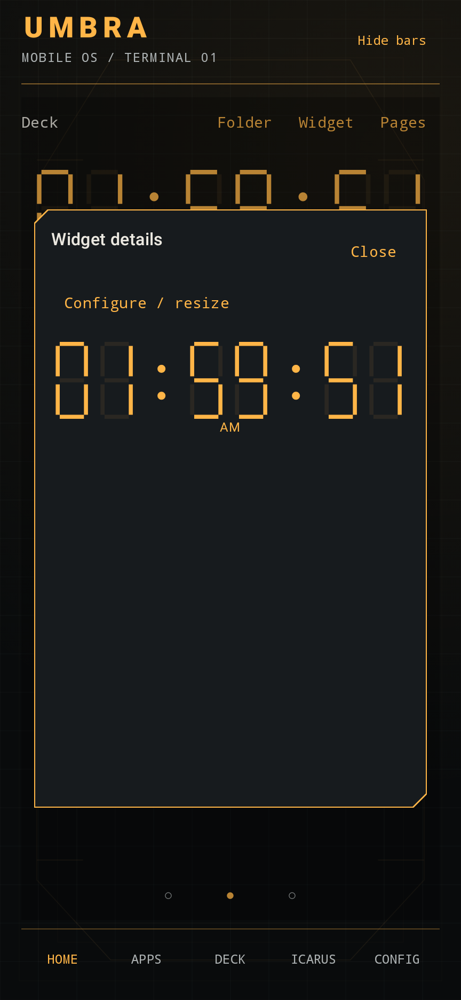

# UMBRA Mobile 2.1 — Phase 2.1

Native Kotlin / Jetpack Compose Android launcher for Samsung Galaxy S24+, alongside the existing ICARUS project.

## Download and install

- [Download Phase 2.1 debug APK](https://github.com/thekiddam-code/munza69/raw/refs/heads/main/UMBRA/downloads/umbra-mobile-debug.apk)
- [Download APK ZIP](https://github.com/thekiddam-code/munza69/raw/refs/heads/main/UMBRA/downloads/umbra-mobile-apk.zip) — extract before installing.
- [Download full Android Studio project](https://github.com/thekiddam-code/munza69/raw/refs/heads/main/UMBRA/downloads/umbra-mobile-source.zip)
- [Download coordinated lock-screen wallpaper](https://github.com/thekiddam-code/munza69/raw/refs/heads/main/UMBRA/downloads/umbra-lock-screen.png)
- [SHA-256 checksums](downloads/SHA256SUMS.txt)

Install over Phase 1/2 to preserve settings. Select **Settings → Apps → Choose default apps → Home app → UMBRA**. Choose **One UI Home** there to restore Samsung. The persistent **Show bars / Hide bars** header control toggles supported Android bar visibility in both directions.

## Phase 2.1

Independent Minimal/Enhanced/Cinematic visual detail; borderless icons; persistent folders and home pages; five clock styles; real cached Open-Meteo weather; standard Android widget hosting; unified icon-origin/panel transitions; authenticated ICARUS instant controls with current Rocket League names and messages.

Retained Phase 2: supported immersive fullscreen; real configurable status panel; native swipe Command Center and system dashboard; nine independently controlled motion categories, profiles, intensity and master override; native ICARUS pairing/Engineering/Lounge/Simulator controls; Customization Studio; validated versioned settings import/export; coordinated static lock wallpaper.

ICARUS native pairing uses your existing server PIN and Android Keystore-encrypted local credentials. Keep Tailscale connected separately. No ICARUS server/simulation change is required. Native notifications, system gestures, keyguard, biometrics, calls, settings, and One UI fallback remain Android-managed.

## Source and documentation

Open [umbra-mobile](umbra-mobile/) in Android Studio. Windows: `umbra-mobile\build_umbra.bat` with JDK 17 or 21 and Android SDK 35.

- [Install, build, and operation guide](umbra-mobile/README.md)
- [Configuration schema and privacy](umbra-mobile/CONFIGURATION.md)
- [Phase 2.1 feature checklist, results, limitations, and next steps](umbra-mobile/PHASE21_REPORT.md)
- [ICARUS integration and current Rocket League source](umbra-mobile/ICARUS_INTEGRATION.md)
- [Physical-device acceptance checklist](umbra-mobile/TESTING.md)

The debug APK builds successfully: 48 tests pass, lint has zero errors (13 warnings), and the signing certificate matches Phase 2. Host Android 11/14 UI testing is distinct from physical Samsung acceptance. Device notification access, actual Keystore/wallpaper/system gestures, live ICARUS/Tailscale behavior, and measured performance remain phone checks. This is a development-signed build, not a store release.

## Host Android UI preview

These images render the actual Activity/Compose UI in Robolectric's host Android runtime; they are not physical phone screenshots. Missing host telemetry is displayed as unavailable.

Samsung’s final cross-app animation, physical widget-provider compatibility, and live game execution remain device acceptance items. No exact One UI animation parity is claimed.
