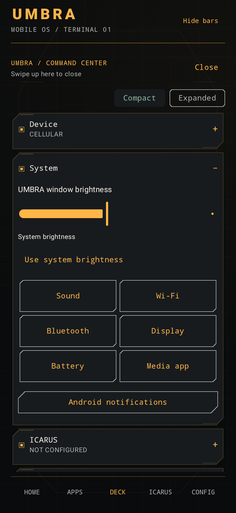
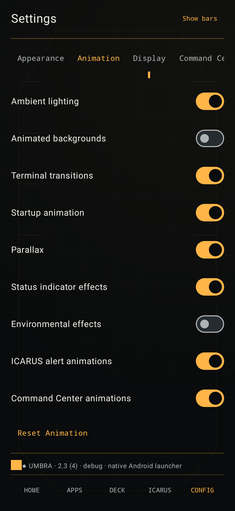

# UMBRA Mobile 2.3

Native Kotlin / Jetpack Compose Android launcher for Samsung Galaxy S24+, alongside the unchanged ICARUS project.

## Download / install

- [Debug APK](https://github.com/thekiddam-code/munza69/raw/refs/heads/main/UMBRA/downloads/umbra-mobile-debug.apk)
- [APK ZIP](https://github.com/thekiddam-code/munza69/raw/refs/heads/main/UMBRA/downloads/umbra-mobile-apk.zip) — extract before installing.
- [Full Android Studio project / Windows build script](https://github.com/thekiddam-code/munza69/raw/refs/heads/main/UMBRA/downloads/umbra-mobile-source.zip)
- [Coordinated lock-screen wallpaper](https://github.com/thekiddam-code/munza69/raw/refs/heads/main/UMBRA/downloads/umbra-lock-screen.png)
- [SHA-256 checksums](downloads/SHA256SUMS.txt)

Install over the previous signed build to preserve local settings. Choose **Samsung Settings → Apps → Choose default apps → Home app → UMBRA**. Choose **One UI Home** there to switch back. The persistent Show bars / Hide bars header control remains available.

## Phase 2.3

Shared snap grids and contextual long-press editing; draggable collapsed module headers; persistent positions/sizes/visibility/expansion; remembered Compact/Expanded Command Center; temporary amber placement guides; no permanent Widget Options rows; full native Instant Buttons editor and supported output parameters; unlimited-by-six selected-button wrapping/scrolling; compact Settings and per-tab status preferences.

The existing Enhanced industrial appearance, Adaptive animation engine, unified transitions, native launcher/apps, pages/folders, clocks/weather, standard Android widget hosting, native ICARUS pairing/controls, and One UI recovery are preserved. Local layouts migrate without resetting widget IDs or PC settings. Physical Samsung animation parity and live device/server compatibility are not claimed from host tests.

**Build verified:** 68 tests pass, lint has zero errors (13 warnings), both APKs assemble, and the signing certificate matches the previous build.

## Documentation

- [Installation / operation / Windows build](umbra-mobile/README.md)
- [Implementation, results, limitations, next steps](umbra-mobile/PHASE23_REPORT.md)
- [Layout migration and recovery](umbra-mobile/LAYOUT_MIGRATION.md)
- [Instant Buttons / exact ICARUS outputs](umbra-mobile/ICARUS_OUTPUTS.md)
- [Configuration schema / privacy](umbra-mobile/CONFIGURATION.md)
- [Host and physical acceptance testing](umbra-mobile/TESTING.md)

Actual native Activity/Compose host renders are stored in `umbra-mobile/verification/phase23/host-renders/`; these are not physical phone screenshots or performance measurements. Earlier phase reports remain historical evidence.

