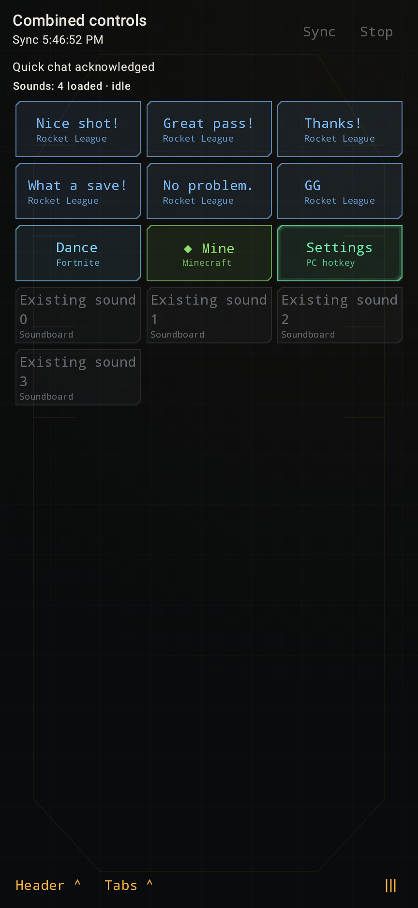

# UMBRA Mobile 3.3

Native Kotlin / Jetpack Compose launcher, alongside the preserved ICARUS project.

**New in 3.3:** windowed mode uses one Fullscreen recovery button; category footers use custom vector icons. Optional silver Arctis and Save Clip tiles reuse the mixed picker. The [separate PC API update/setup](pc-update/phase49-host-actions/README.md) is required; actual Windows routing/capture verification is still pending.

**Retained from 3.2:** HOME → **Full screen** collapses header/footer to a compact recovery strip. Add **Mixed controls** or configure a Button widget with **mixed + Fill available page + up to 12 button columns** to combine Rocket League, Fortnite, PC hotkeys and sounds in one independently customizable grid. Category colors: game blues, Minecraft green, PCB green/static glow, soundboard cool white. Saved layouts and PC audio preferences remain.

**HOME | APPS | DECK | SIMULATOR | ICARUS | CONFIG**

- HOME: independent presets and customizable Button/Soundboard widgets. Mix hotkeys and sounds on a page; keep Rocket League and Fortnite selections on separate pages. Each instance owns its selection, title, appearance, arrangement and command overrides. Denser responsive grids support up to eight page columns.
- DECK: Engineering and Android Device controls. Command library and Instant Buttons navigation are removed while existing mappings remain available.
- SIMULATOR: Rocket League, Fortnite, Minecraft, Soundboard and ship simulation.
- ICARUS: existing PC remote view and shared connection manager.
- CONFIG: server PIN entry and existing server-owned audio output settings. Optional small **||| Recent apps** footer shortcut requires manual Android Accessibility enablement; it cannot read screen content or control gestures.

Engineering widgets, six-tab PC indicator in fullscreen, existing layouts, sound mappings/output preferences, native Android widgets, motion/detail controls and One UI recovery remain. Long-press HOME page title → Add widget; long-press a widget header → Configure. TV controls remain retired.

## Download / install

- [Debug APK](https://github.com/thekiddam-code/munza69/raw/refs/heads/main/UMBRA/downloads/umbra-mobile-debug.apk)
- [APK ZIP fallback](https://github.com/thekiddam-code/munza69/raw/refs/heads/main/UMBRA/downloads/umbra-mobile-apk.zip) — extract before installing.
- [Complete Android Studio project and Windows build script](https://github.com/thekiddam-code/munza69/raw/refs/heads/main/UMBRA/downloads/umbra-mobile-source.zip)
- [Coordinated lock-screen wallpaper](https://github.com/thekiddam-code/munza69/raw/refs/heads/main/UMBRA/downloads/umbra-lock-screen.png)
- [SHA-256 checksums](downloads/SHA256SUMS.txt)

Install over the previous signed UMBRA build to retain settings. Choose Samsung Settings → Apps → Choose default apps → Home app → UMBRA. Choose One UI Home there to restore Samsung's launcher. The Show bars / Hide bars header control remains available.

Keep using the existing Phase 4.9 Windows/soundboard-capable ICARUS companion and private soundboard library; configure its address in CONFIG → ICARUS and pair with its PIN. The older ICARUS tree on main lacks extended monitor/soundboard APIs and should not replace that working server. Native desktop video/input streaming is not exposed by the inspected companion; PC Remote Deck opens the configured existing browser interface. Older versions do not report a PC name, and the UI says so. Address classification does not verify the actual Tailscale route.

## Phase 4.9 PC bulk sound import

[Download the PC update ZIP](https://github.com/thekiddam-code/munza69/raw/refs/heads/main/UMBRA/downloads/umbra-pc-phase49-bulk-update.zip). [Apply instructions / backup and compatibility checks](pc-update/phase49/README.md).

Adds **Soundboard → Add many sounds** to the existing Phase 4.9 website on port 8765: multi-file/folder import, progress, cancellation, duplicate skipping and 512 sounds / 256 MiB library capacity. Reuses existing storage, authentication, conversion and playback. Preserves audio output/profile and simulation data. Save the voyage, stop the companion normally, and run the included installer against the original ICARUS folder. It verifies exact source and backs up original code and the actual library before applying. **The private PC site was unreachable from this environment and has not been deployed remotely.**

## Verification and documentation

The 3.3 Android build/tests/lint/signing and host-action fixture tests are recorded in [current executed results](umbra-mobile/verification/host33/RESULTS.txt). Signing matches the previous distributed build. Top-level permissions remain unchanged; the optional Recents shortcut still requires a manual Android Accessibility grant. The unchanged 3.1 PC package retains its historical 42 service, 10 Chromium and 4 installer checks using isolated generated audio and fake Windows output; these are not recounted as new 3.2 PC tests.

[Current setup/migration/limits report](umbra-mobile/HOST33_REPORT.md) · [Exact executed evidence](umbra-mobile/verification/host33/RESULTS.txt) · [Build/install instructions](umbra-mobile/README.md) · [Configuration schema 7/privacy](umbra-mobile/CONFIGURATION.md).

Host screenshots and HTTP fixtures are not physical phone/PC measurements. Actual S24+/Windows audio/game delivery, native Recents/gestures, Tailscale routing, special-access grants and measured battery/frame performance remain device checks. Historical reports remain evidence for earlier versions.

[Download the new Phase 4.9 Host Actions API/setup ZIP](https://github.com/thekiddam-code/munza69/raw/refs/heads/main/UMBRA/downloads/umbra-pc-phase49-host-actions.zip). Install on the original stopped companion, configure the existing Moments storage folder and saved macro, then restart normally. It has not been deployed from the cloud. Sonar uses an internal local API; Save Clip still requires actual GG acceptance and clip verification. [API, backup, rollback and physical test instructions](pc-update/phase49-host-actions/README.md).
