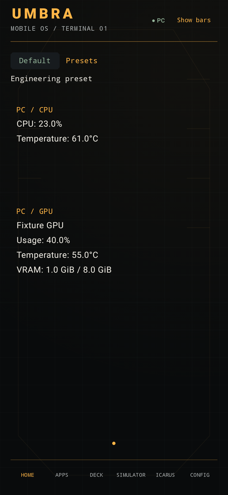
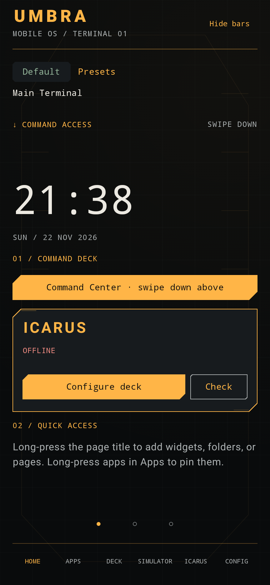

# UMBRA Mobile 3.0

Native Kotlin / Jetpack Compose Android launcher for Galaxy S24+, beside the unchanged ICARUS project.

**HOME | APPS | DECK | SIMULATOR | ICARUS | CONFIG**

- HOME: named independent preset dashboards, pages, app shortcuts, folders and widgets.
- DECK: Command library, Engineering, Soundboard, Instant Buttons and Android Device controls.
- SIMULATOR: separate Rocket League, Fortnite, Minecraft and ship simulation controls.
- ICARUS: native PC pairing/connection and access to the configured PC Remote Deck.
- CONFIG: system, appearance, connection and server-owned soundboard audio settings.

Engineering uses the existing Windows companion: CPU, GPU, RAM, power/battery, network and supported fixed PC actions. Add those modules through the HOME widget picker; drag, snap, resize, collapse, configure and place instances independently in any preset. Visible modules share one polling loop and the existing native connection controller. Missing or stale sensors remain unavailable.

The compact **● PC** header indicator appears on all six tabs. Tap for reported PC name, actual authenticated connection status, conservative address-class detection, HTTP round-trip latency and Reconnect. Hide it in CONFIG → ICARUS. No widget arrangement or Android fullscreen setting changes when it is hidden.

Samsung TV controls are removed from UMBRA. Old mappings are preserved as inert migration data; shared TV backend and Samsung's native remote are untouched. Existing soundboard audio output preferences stay on ICARUS.

## Download / install

- [Debug APK](https://github.com/thekiddam-code/munza69/raw/refs/heads/main/UMBRA/downloads/umbra-mobile-debug.apk)
- [APK ZIP fallback](https://github.com/thekiddam-code/munza69/raw/refs/heads/main/UMBRA/downloads/umbra-mobile-apk.zip) — extract before installing.
- [Complete Android Studio project and Windows build script](https://github.com/thekiddam-code/munza69/raw/refs/heads/main/UMBRA/downloads/umbra-mobile-source.zip)
- [Coordinated lock-screen wallpaper](https://github.com/thekiddam-code/munza69/raw/refs/heads/main/UMBRA/downloads/umbra-lock-screen.png)
- [SHA-256 checksums](downloads/SHA256SUMS.txt)

Install over the previous signed UMBRA build to retain settings. Choose Samsung Settings → Apps → Choose default apps → Home app → UMBRA. Choose One UI Home there to restore Samsung's launcher. The Show bars / Hide bars header control remains available.

Keep using the existing working Windows/soundboard-capable ICARUS companion and private soundboard library; configure its address in CONFIG → ICARUS and pair with its PIN. The older ICARUS tree on main lacks extended monitor/soundboard APIs and should not replace that working server. Native desktop video/input streaming is not exposed by the inspected companion; PC Remote Deck opens the configured existing browser interface. Older versions do not report a PC name, and the UI says so. Address classification does not verify the actual Tailscale route.

## Verification and documentation

**Build verified:** 89 Android tests pass; lint has zero errors (13 warnings); app and device-test APKs assemble. Signing certificate and permissions match 2.3.1.

See [executed Phase 3 results](umbra-mobile/verification/phase3/RESULTS.txt), [complete implementation/migration/limits report](umbra-mobile/PHASE3_REPORT.md), [installation/build instructions](umbra-mobile/README.md), and [configuration schema/privacy](umbra-mobile/CONFIGURATION.md).

Native host renders below use explicit TEST-PC/Fixture GPU responses; they are not physical phone screenshots or measurements from the user's Windows PC. Physical S24+/Windows/Tailscale, audio/game delivery, gestures and battery performance remain device checks.

Previous Phase 1/2/2.1/2.3 reports and verification artifacts remain historical evidence. The original Android launcher, adaptive animation profiles, independent effect switches, unified transitions, native widget hosting and One UI recovery remain.
