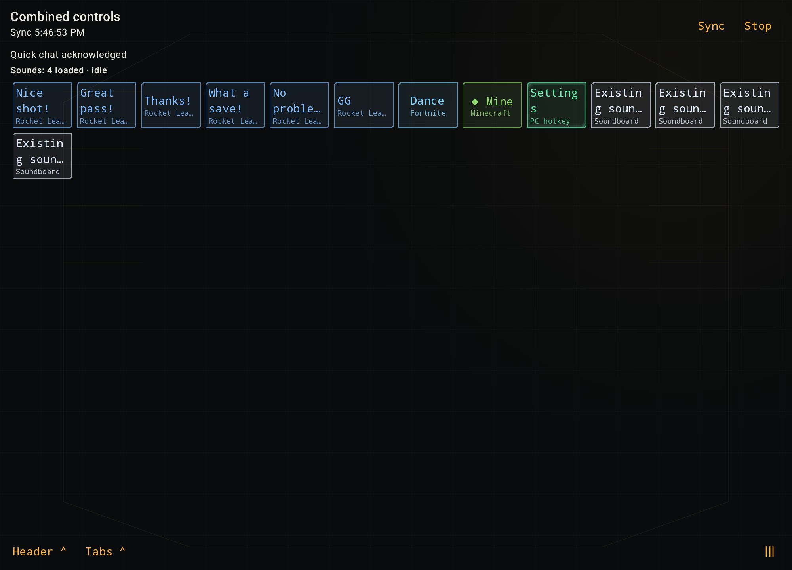

# UMBRA Mobile 3.2 — full-page HOME and mixed controls

This update extends the existing native launcher. It changes no PC sound library, audio output/profile, authentication endpoint, simulation, Windows driver, TV backend or server runtime. Package `com.umbra.mobile`, version 3.2 / code 8; install over the distributed signed 3.1 APK without uninstalling.

## HOME fills the available screen

Tap **Full screen** in the HOME preset strip to collapse both header and footer. This hides launcher branding, the HOME status panel, preset/page headings, terminal introduction, page dots, terminal footer shortcuts and the six-tab footer while HOME is active. Side margins shrink from 20 to 4 dp. Android safe insets, keyboard handling, calls and protected edge gestures still apply. Other tabs retain normal chrome.

A single compact **48 dp recovery strip** remains below the preset. **Header ⌃** restores the header; **Tabs ⌃** restores navigation. Each works independently. The optional shared PC indicator moves to that strip while the header is collapsed; the existing Recents shortcut remains available there when the footer is collapsed. No controls float over widget buttons. Restoring Tabs allows access to all six destinations; returning HOME preserves its collapse choices.

For individual switches: long-press the HOME page heading → Edit Home, or **CONFIG → Appearance → Collapse HOME header / Collapse HOME footer**. Appearance reset restores expanded chrome. Collapse choices persist globally across HOME presets and activity recreation; they do not replace or edit any preset layout. Visual Detail, animation master/effect selections, Android bar preferences and native widget bindings are independent. Swiping horizontally still changes pages when page dots are hidden. Restore Header to switch presets or edit the page.

## One widget for quick chat, hotkeys and sounds

The requested large mixed-widget option is implemented. Long-press HOME page heading → **Add widget → Mixed controls · games, hotkeys & sounds**. Newly added mixed widgets use the available page width and height. Existing Button widgets keep their previous group, selections and size until deliberately changed.

For an existing widget: long-press its header → Configure → set **Button set = mixed** and enable **Fill available page**. Set **Button columns = 12** for a single wide tablet widget (the outer HOME page grid is separate). Use **Sync commands and sounds**, then choose exactly which Rocket League, Fortnite, Minecraft, PC and sound buttons to include. Save commits the existing atomic draft; Cancel leaves the saved selection unchanged. Sound entries remain separately identified with `sound:<original-id>`. Different widget instances retain independent selections, command overrides, titles, appearances, layouts and sizes.

Fill available page derives rendered rows from the actual HOME viewport, adapting to header/footer collapse, orientation and insets. It does not write a new arrangement simply because screen size changes. Inner button grids support 1–12 columns; 12 requires approximately 648 dp of usable widget width at the minimum 54 dp cell pitch. Narrower views reduce displayed columns without overwriting the chosen value. Full-page width uses the entire rendered HOME grid, including tablet density adaptation. Manual width/height preferences remain available when Fill is disabled. Existing other widgets are retained and normalized for collisions; use a dedicated page for a mixed widget intended to occupy the whole page. Large selections scroll inside the widget. There is no six-button limit. New button positions fill rows left-to-right; explicitly saved positions/sizes are respected.

The unified grid uses the same long-press/drag/resize engine as existing controls. Long-press the outer header to arrange the widget; long-press a button to arrange that button. Command customization stays local to its widget. Sound button Configure exposes the existing server favorite action; it never turns sound playback into quick chat. Sync retrieves both catalogs independently. Stop acts on the shared ICARUS sound player. Sound errors, actual loaded count and reported playback state remain visible; acknowledgment is not proof of audible output or game execution.

## Category colors

| Button type | Appearance |
| --- | --- |
| Rocket League quick chat / messages | Blue |
| Fortnite emotes | Blue, slightly cooler/lighter |
| Minecraft mining controls | Green |
| PC hotkeys / macros | PCB green with restrained static edge glow |
| Soundboard | Cool white |
| Simulation | Existing amber |

Each button also displays a small category label and exposes its type to accessibility, so color is not the only cue. Category identity applies to game/button widgets, the mixed grid and the native Simulator/Soundboard grids. Widget accent still styles its container/header; categories style individual controls. The PC glow is a cached static draw, with no timer, flashing, blur or animation loop. Colors and static detail remain with optional animations disabled. Unsupported sensors or commands are not fabricated.

## Persistence and integration

Configuration **schema 7** reads schemas 2–7 using the existing DataStore key. New booleans `homeHeaderCollapsed`, `homeFooterCollapsed` and widget `fillPage` default false for old layouts. New `buttonSet = mixed` adds a presentation option; original command definitions, IDs, `widgetButtonSelections`, native bindings, preset snapshots, URLs, motion/detail and audio preferences remain. Portable exports still exclude credentials and clear foreign Android widget bindings.

Mixed sound references are passed to the existing shared `SoundboardController`, using the original authenticated `api/sounds/library`, `api/sounds/play`, `api/sounds/stop` and `api/sounds/edit` contracts. Commands continue through the existing `InstantController`. Playback uses a fresh request ID and the original server ID. No sound is sent to the game action endpoint. No independent playback engine, connection manager or local audio-output copy is added. Widget sessions remain lifecycle/visibility gated; stopping the launcher cancels pending work and does not start idle sound polling.

The previously supplied Phase 4.9 bulk-import PC package remains unchanged. Apply it locally only if needed, following its own matching-source/verified-backup instructions. This Android update is not a claim that the private PC website was deployed or changed.

## Executed validation and limits

See [exact build/test/signature evidence](verification/home32/RESULTS.txt). The final full build runs Android host tests, lint, app assembly and device-test APK assembly. Focused SDK 30/34 tests verify reclaimed HOME viewport space, independent recovery, persistence after recreation, navigation to Apps and back, unchanged page data, all 13 selected mixed controls displayed inside one page-sized widget, separate authenticated quick-chat/sound endpoints, original sound ID plus request ID, no audio-output writes and no post-stop idle requests. An additional native SDK34 tablet-landscape case verifies 12 distinct buttons across the same row of one full-width widget. Pure tests cover schema-6 defaults, strict new field types, adaptive rendering without saved-cell mutation, collision avoidance, dense row packing and static category identification.

Host renders use generated server fixtures, not the user's PC. Actual Galaxy S24+/One UI gestures, native HOME selection, Accessibility Recents grant/action, third-party providers, Windows audio/game delivery, large fonts/landscape usability and measured frame/battery behavior remain physical checks. The 48 dp recovery strip and protected Android insets intentionally retain space; the launcher never traps the user in fullscreen. Very large catalogs scroll rather than shrinking controls below their supported heights. Windows `build_umbra.bat` is included but not executed on this Linux host. SDK35/Build Tools35.0.0 and JDK17/21 build instructions remain in README.

Recommended next work: install-over-upgrade checks on the S24+, customize a real game/sound preset and measure its touch/scroll/battery behavior; verify native gestures and Recents. Individual single-button HOME widgets are not needed for this mixed-widget solution and are not introduced in this update.

SDK34 landscape tablet host render (generated fixtures, not a physical tablet):

