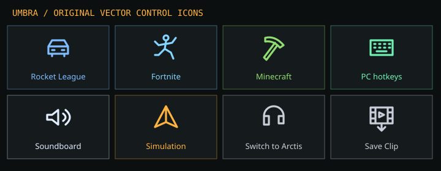
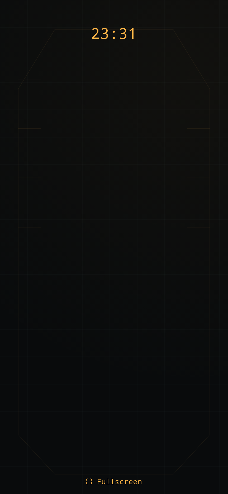

# UMBRA Mobile 3.3 — fullscreen recovery, vector footers and paired host actions

Package `com.umbra.mobile`, version 3.3 / code 9. Updates the existing launcher; install over the previous signed APK to retain settings/presets. [Exact executed evidence](verification/host33/RESULTS.txt).

## Windowed launcher

When the existing Android fullscreen setting is off (`immersive=false`, including Show bars), global branding/header/status and named tab footer are replaced by one **⛶ Fullscreen** button. HOME's preset/page headings, terminal introduction/footer and dots are also hidden in this simplified view. Body controls remain functional. Tapping the button invokes the existing native bar/fullscreen implementation and restores the normal fullscreen navigation according to the retained HOME collapse preferences.

The selected primary destination, current HOME page/preset, query, layout and widget selections remain through the transition. The transition does not send a HOME intent, switch presets or reset the desktop. Android's temporary system-bar reveal by edge swipe does not rewrite this preference or trigger the simplified layout. Protected system gestures/insets remain native. The separate HOME focus/collapse preferences from 3.2 remain independent.

## Custom icons and optional silver tiles

The user-approved category footer text is replaced with **original Android vector line artwork**, not emoji glyphs: car (Rocket League), dancer (Fortnite), pickaxe (Minecraft), keyboard (PC hotkeys), speaker (Soundboard), and ship (Simulation). Category colors remain; the full category name stays in accessibility semantics. There is no image download, icon font dependency or animation loop. Titles and user command definitions are retained.

The existing mixed-widget picker adds **Switch to Arctis** and **Save Clip**, both silver. Their footers use headphones and a film/save arrow. Open widget header → Configure → Button set mixed, search/select the silver **Host action** entries, then Save. They are optional and excluded from implicit default selections; existing widgets do not gain automatic host actions. Their stable IDs are `host:arctis` and `host:save-clip`. Existing widget-ID selections, inner grids and preset snapshots store their positions; there is no second button library. The picker offers full-row 48 dp selection targets.

The old generic Save Clip macro, if advertised, remains available as an ordinary PC macro; choose the silver Host action for the new verification path. Android sends no embedded key binding.

## PC update required

The requested Sonar endpoint did not exist. A separate [matching Phase 4.9 PC package](../pc-update/phase49-host-actions/README.md) creates it behind the existing bearer pairing/origin guards. It changes only server.py and adds one standard-library module. It preserves the simulation, soundboard library/output/profile, existing authentication, Windows controls, microphone/VoiceMeeter configurations and bulk/volume patches. The exact-source installer backs up code/private settings, refuses mismatched source and requires a normal stopped-server install. It has not been deployed remotely; the private PC address was unreachable here.

Arctis requests discover GG's local internal API, enumerate physical render endpoints and return a picker for multiple matches. A selected available identity is remembered on the PC. Only Game, Chat, Media and Aux route setters are exposed. All four are read back, and the microphone route ID is compared before/after before the API reports verified. Partial/unconfirmed results remain errors with conservative output rollback. Classic mode/known response shapes are required; Streamer mode is not silently changed. No VoiceMeeter/microphone/Windows-default setter is called.

Save Clip now has a paired request/status API. It reads the host's saved Save Clip macro each time, sends Windows scan-code input rather than the older virtual-key event path, and observes the locally configured real Moments folder for a new stable video file. This still cannot bypass GG rejecting synthetic input. The response separates pending, unverified and new-file-observed states. “Hotkey sent” alone is never labeled clip success. A detected file is not certified Gallery registration/playability or trigger attribution during concurrent autoclip. Capture state remains explicitly unknown, rather than fabricated.

Run the PC setup helper while stopped to point at the existing GG Moments storage folder and, if needed, update the saved macro to match GG. Changing the key later in the desktop configuration is picked up without changing Android. No clips are moved, deleted, uploaded or recorded by another engine. No drivers, elevated input workaround, fake game registration or new Windows service are introduced.

Android uses its existing IcarusClient/InstantController/token vault and request gate. Actions are explicit taps, UUID-scoped and never automatically replayed. Clip status polling is visibility/lifecycle gated; refresh preserves pending requests. The PC observer is bounded to one requested check, not an idle background scanner. Authoritative routing choice and clip-folder settings stay on the PC; no conflicting Android copy is introduced. Native DataStore schema remains 7 because only stable existing selection/layout fields are used.

## Tests and remaining acceptance

[Executed results](verification/host33/RESULTS.txt) record the exact native build/tests/lint/APK signature plus host software tests. New Android tests cover one-button recovery and preserved page/preset/tab/query, explicit optional selection, silver tile/API routing, multiple Arctis choices, no key arrays in Android, unverified clip responses, restart persistence, inherited presets/positions and custom vector identity. Existing full regressions remain included. Host tests use actual HTTP handlers and isolated fixture GG routes/files/native-input functions; no actual Windows DLL, Sonar engine or Moments capture is certified here.

Physical acceptance still required: install over 3.2; add/move both tiles on a real preset; restart the launcher; install/configure the matching PC package; with GG Classic/Arctis available, compare actual Game/Chat/Media/Aux destinations and confirm microphone/VoiceMeeter unchanged; with Moments **actually capturing**, press Save Clip and inspect the new clip in Moments. If injected input is rejected despite a working physical binding, the saved-clip requirement remains unresolved on that GG/session; the UI must continue reporting unconfirmed. Native One UI gestures/Recents/special grants, actual audio/game output and measured battery/frame timing remain physical checks.

Recommended follow-up is the actual Windows/Android acceptance above and, if scan-code input is still rejected, a verified capture integration for that installed GG version. No universal direct manual-capture API is claimed. Windows BAT files are provided but were not executed on this Linux host.

Approved custom vector artwork (generated from the exact compiled paths, not emoji):

Native SDK34 host render of the simplified windowed view (fixture, not physical phone):

